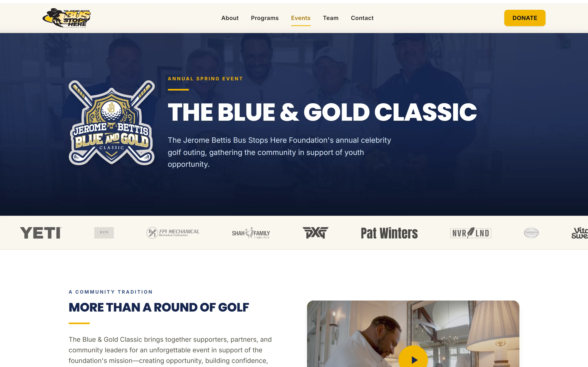
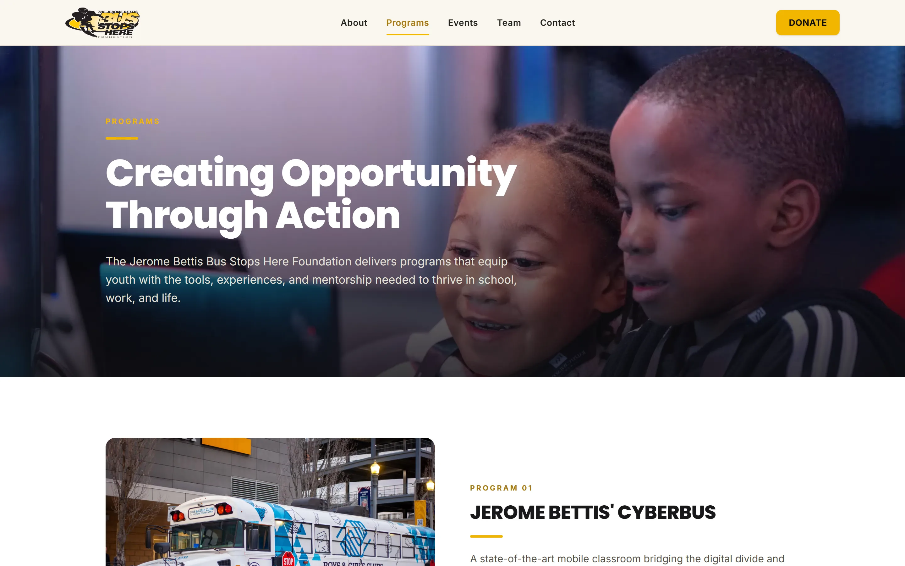

## The client

The Jerome Bettis Bus Stops Here Foundation is a youth development nonprofit based in McKees Rocks, PA. Its signature fundraiser is the Blue and Gold Celebrity Golf Classic, a celebrity golf outing with Notre Dame alumni and Pittsburgh sports names. I have been the foundation's web person since the summer of 2022, working with Beth Vietmeier, who runs it.

## The problem

**A site nobody could change.** When Beth handed me the foundation's website in July 2022, it had been built in Webflow by a developer who was no longer involved. It worked, but nobody at the foundation could meaningfully change it, and the one person who could was gone.

**Then two brands for one organization.** In October 2022 Beth asked about a website for the Blue and Gold Classic, and I built one on its own domain. It served the event through four cycles, but by 2026 the event sold out on repeat sponsors and referrals with no marketing at all. Donations already went to the foundation, but one organization was split across two brands, with two hosting bills and two sites to keep current, and the event no longer needed a site of its own.

**And quiet problems on the main site.** By 2026 the site I had built in 2022 had gone stale in ways that are easy to miss from the inside. A campaign that had ended was still running as the homepage banner, so an active organization read as one that had stopped doing things. The Programs page wasn't rendering, the newsletter signup returned an error, and on a phone the donate button was missing entirely.

## What I built

**A site the foundation could run.** In July 2022 I rebuilt the foundation's site on a platform the people who work there could run, kept the existing design rather than reopening it, and started the care plan the same month.

**A site of its own for the tournament.** The Blue and Gold Classic got its own website before the end of 2022, and every autumn I refreshed it for the coming year with the new sponsors and the new date.

**One site, not two.** In 2026 the event became a section of the foundation site, with everything a sponsor or attendee needs and the foundation's own donate path. I kept the tournament's domain registered and redirected every URL on it to the new event page, so its search rankings and years of old links and bookmarks still land in the right place.

**The fixes first.** Before any design work, I fixed the missing mobile donate button, the broken newsletter signup, and the Programs page, and I took the campaigns that had ended off the site so what is left is what the foundation is doing now. The site now shows the impact figures the foundation publishes: more than 10,000 youth served and more than 100 community partners.

**Only what the event needed.** I kept the event page to basic event information, the sponsorship PDF they already had, and photos. The event doesn't have a marketing problem, so building it a marketing system would have spent donor money on something that solves nothing.

## What changed

The foundation now has one website and one hosting bill. The donate button works on a phone, the newsletter form works, and the Programs page shows what the foundation actually does. The Blue and Gold Classic still owns its search results, and every one of those searches now arrives at the foundation. Two of the three sites in this story are gone and I built both of them, which is what it looks like when the person who built something sticks around long enough to see what the organization actually needs.
