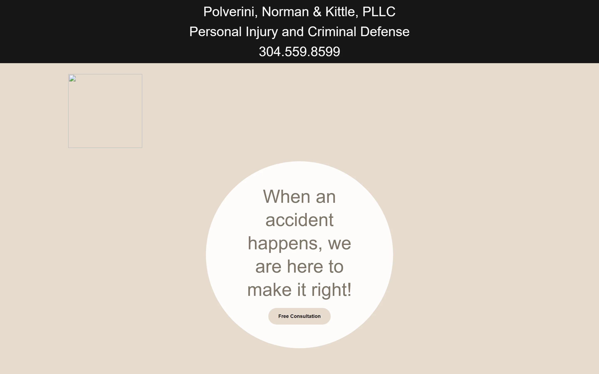

## The firm

Polverini & Wiater is a civil and criminal litigation firm in Wellsburg, West Virginia, practicing across West Virginia, Ohio, and Pennsylvania. Jake Polverini first asked me to look at the firm's web presence in June 2023, and I recorded an audit of where it was falling short and what a real site could do for the firm. He didn't act on it then, but in June 2025 the timing was right, and the firm has been a client ever since.

## The problem

By June 2025 the firm was in the middle of a rebrand. One partner was leaving and another was coming in, so the name was changing from Polverini, Norman & Kittle, PLLC to Polverini & Wiater, PLLC, and the domain was moving from pnk-law.com to pw-legal.com. Everything the public saw was about to describe a firm that no longer existed.

There wasn't much for the public to see in the first place. The old site was a GoDaddy Website Builder page with a homepage, a couple of FAQs, and a way to get in touch. It said nothing about the practice areas, showed no case results, and told no story about the attorneys, which is a hard place to start for a firm that wants to be taken seriously in three states.

The timing raised the stakes, because the new site had to be ready on the day the new name went on the door. It was going to be the thing that announced the firm.

## What I built

I learned the business, scoped the site, and made every structural and strategic decision about it, and I managed the build from start to finish. The result was a real marketing site with a custom design, dedicated pages for practice areas, case results, FAQs, and contact, and a homepage that positions the firm across West Virginia, Ohio, and Pennsylvania. It went live on September 26, 2025, the same day as the rebrand.

Along the way I cleaned up the tools the firm had collected over the years, consolidating what I could and removing the GoDaddy add-ons it no longer needed.

In September 2026 I rebuilt the site myself, moved it off WordPress, and shut down the server it ran on. The design and the pages stayed the same, so there was nothing for the firm to relearn. Taking the site apart page by page also turned up problems from the original build, and I fixed them:

- **The sitemap listed 3 pages while the site served 286**, so search engines were being told about almost none of it. The new sitemap lists every real page.
- **No page had a description for search results.** Every page has one now, written from its own copy.
- **232 FAQ and case result addresses were blank pages.** Each one now sends visitors to the page that actually carries that content, so nobody arriving from a search lands on an empty page.

The contact form moved too, with spam screening in front of it, so what reaches the firm comes from real people.

## What changed

The firm launched its new name with a website that matched it, on the same day. The rebuilt homepage scores 97 on mobile and 100 on desktop in Google's Lighthouse speed test as of November 2026. The firm is on my monthly care plan, so I handle the site, the updates, and whatever needs to ship, and the site represents the firm properly in all three states where it practices.
