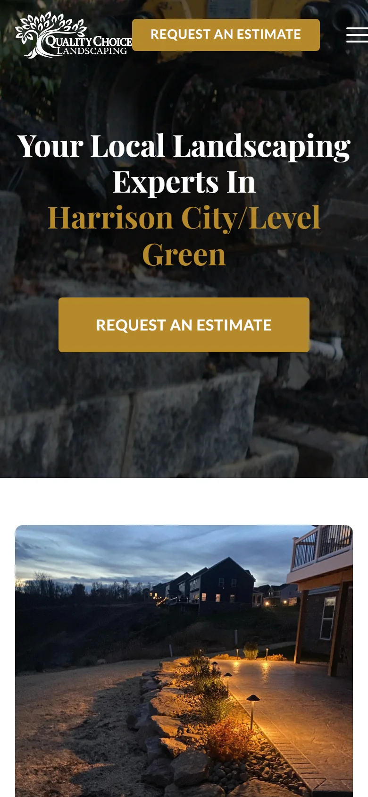

## The client

Quality Choice Landscaping is a landscaping company in Murrysville, PA, run by Austin. When we started working together in January 2023 it was mostly a mowing and maintenance business, and since then it has grown into design and build work like patios, walkways, and outdoor living spaces. They have been a client the whole time and are still on my care plan today.

## The problem

Austin came to me about the website. He had built a page on Wix himself, and he was the first to say he wasn't technical. It was enough to exist online but not enough to grow, and once I looked closer, the website turned out to be the smallest problem.

**No business email and no scheduling.** There was no Google Workspace, no email signatures, and no booking tool, so when a lead came in, Austin was playing phone tag to set up a consult.

**A domain that didn't match the name.** The site lived on qcscape.com, a shortened version of the brand, and they didn't own qualitychoicelandscaping.com. Their domains were also spread across several providers.

**Later, a site that couldn't keep up.** As the company leaned into design and build, Austin needed the website to sell that side of the business, and the site I had built in 2023 had become slow to change. A request that should have taken ten minutes took an hour of fighting a page builder.

## What I built

**The foundation first.** Before I wrote any site copy, I set up Google Workspace so the team had real business email and shared storage, built proper email signatures, and set up Calendly so customers could book a consultation themselves. I moved every domain to one registrar, bought qualitychoicelandscaping.com and made it the public face of the brand, and kept qcscape.com running for email so nothing in their existing pipeline broke.

**A real website.** The new site went live in the summer of 2023 with all of their services, team bios, an FAQ, job listings, an employment application, scheduling built into the page, and real photos of their work. They stopped paying for Wix and moved to my care plan, which covers the site and everything else I manage for them.

**An ads test in their busy season.** In the spring of 2025 Austin wanted to push the design and build side, so we ran Meta ads from April 5 through June 1, 2025. The campaign booked 19 on-site consults and its numbers sat in the normal range for home services, but their organic leads, which almost always came from Google, were already keeping the team busy, so we stopped it.

**A faster site for the next phase.** From late 2025 into 2026 I rebuilt the front of the site so changes are quick again, and I kept the content system the team already used so there was nothing for them to relearn. Then I built the design and build page Austin had come in asking for. In September 2026 I moved every service, service area, job listing, team bio, and image into the site itself, and I rebuilt the three forms for maintenance requests, design and build inquiries, and job applications so they still land in the same inboxes. I archived every past submission and shut the old server down, and every public URL stayed where it was.

## What changed

Austin went from a Wix page and phone tag to real business email, self-serve scheduling, a domain that matches his company's name, and a website that sells the work the business is moving toward. In Google's Lighthouse speed test the homepage went from between 79 and 88 on mobile to the mid and high 90s, and it scores 99 on desktop. There is one less server to pay for, patch, and keep alive, and when Austin asks for something new it takes minutes instead of an hour. We have been working together for nearly four years, and every time my tools got better, his site got better with them.
