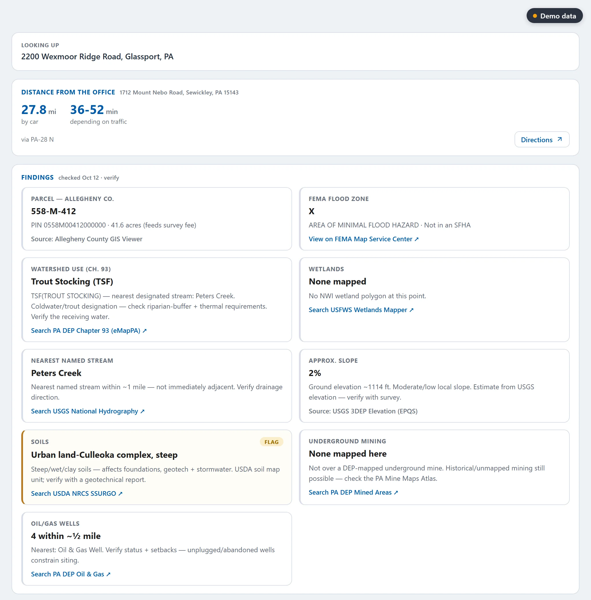
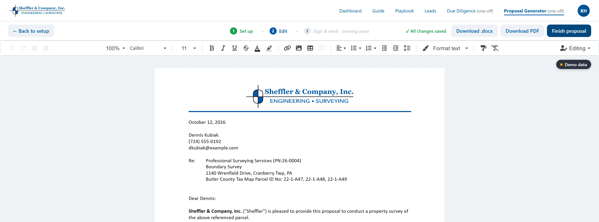

## The firm

Sheffler & Company has surveyed and engineered land in western Pennsylvania for more than fifty years: licensed surveyors and professional engineers working across Pennsylvania, Ohio, and West Virginia. In 2024 they hired me to rebuild their website, and they've been a client ever since.

## The problem

Once I'd watched how the office actually worked, it was clear the website wasn't where their time went. Three jobs were eating it.

**Leads lived in a spreadsheet.** A new tab every year, filled in by hand, with highlighting doing the job of a status column.

**Every proposal started with research.** Before anyone could quote a job, someone had to work out what the property demanded: flood zones, slopes, soils, streams, wetlands, mine subsidence, road ownership, and the zoning and stormwater rules for that specific township. That meant a handful of county and state websites per property, and an engineering proposal could take a couple of hours of real work.

**Then the document itself.** Survey proposals were built by copying from a library of about thirty Word templates, and the aerial exhibit in the back took a screenshot, two other programs, and a paste. About half an hour of every proposal was formatting.

The expensive part of a proposal isn't writing it. It's getting the scope right, because scope drives the price, and a scope that misses something either loses the job or costs the firm the difference. The goal, as the team put it to me, was a response in hours instead of days, because the longer a proposal sits, the longer a client has to shop around.

## What I built

I brought a clickable prototype of the whole thing to their office in Sewickley in June 2026. They said yes in the room, and version one was in their hands 44 days later.

**Site research that cites its sources.** An address goes in, and the portal checks the property against live public data: parcels, flood zones, protected streams, wetlands, slope, soils, underground mines, landslide areas, state highway frontage, and oil and gas wells. Every finding says where it came from and links to it, so the person quoting the job can check it in one click. It also builds the aerial exhibit with the parcel marked.

**A playbook built from their own proposals.** I went through 1,568 proposals they had actually sent over two years and turned them into a playbook: their services, the scope lines they really use, the rules that decide what a job needs, and their fee rules. The company owns it and edits it.

**A proposal generator on top.** Pick the services, tick the scope, and the proposal assembles itself in their format, with their language, ready to download as Word or PDF.

**A lead pipeline that replaces the spreadsheet.** Requests from their website land in the portal on their own, and every lead carries its research and its proposal with it.

*Every portal screenshot here comes from a demo copy running on invented data. None of the leads, people, or properties are Sheffler's.*

## What changed

The leads from their website now land in the portal, site research starts there, and a proposal can go from address to finished document without leaving it. Once the team started using it on real jobs, the requests started coming in: engineering proposals, jobs with many properties, drive time from the office, and a company-wide proposal number ledger. I still add to it most weeks.
