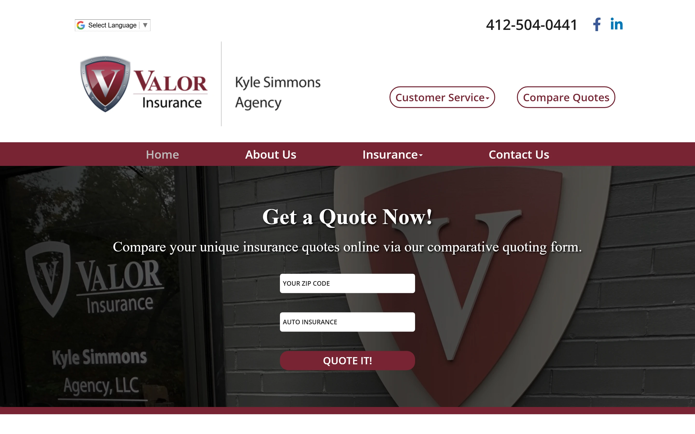
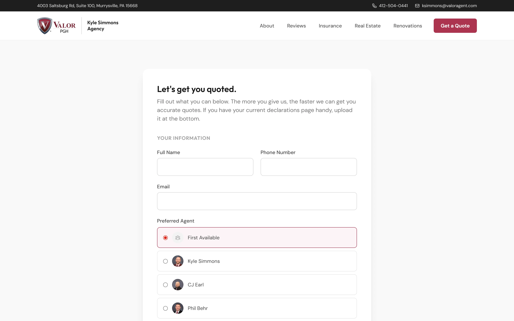

## The client

Kyle Simmons runs three businesses out of one office in Murrysville, Pennsylvania: an independent insurance brokerage called Valor Insurance (PGH) that writes personal and commercial lines through the Valor network, a real estate business called Valor Realty, and PGH Renovations, which he runs with a partner. He wants more commercial accounts, and he spends his days on the road with clients rather than at a desk. In April 2026 he asked me for a new website, and he has kept coming back since.

## The problem

The old website described almost none of that. It was built on a template from Valor corporate, Kyle had no access to edit it, and he had tried for years to get changes made. It led with the name Kyle Simmons Agency while people were typing valorpgh.com into their browsers, so the brand they looked for and the brand they saw didn't match.

The hero was a stock photo with generic copy and a self-service quote widget, and that widget was the part Kyle most wanted gone. People entered the wrong information and got rates that weren't real, so he was correcting false expectations before the first conversation. Real estate and renovations weren't mentioned anywhere, which left two of his three businesses invisible, and his strongest trust signal, years of good reviews from his clients, sat in a carousel nobody scrolled to.

## What I built

Kyle asked for a new website and ongoing help with search. He got the website, along with a set of decisions he hadn't known needed making.

**One brand, three businesses.** The site leads with Valor PGH and uses colors in line with the parent Valor Insurance brand, so nothing feels off when someone clicks between the two. Insurance, real estate, and renovations each have a real place on it, so one relationship covers your insurance, your house, and the renovations on it. I also studied Henderson Brothers, the 130-year-old Pittsburgh agency, to decide what to borrow and what to leave, since they lean on heritage and Kyle leans on being accessible and fast.

**A lead flow in place of the quote widget.** The first step asks for a name, phone number, and email, and it alerts the team the moment it's submitted, so the lead is captured even if the person stops there. The second step is the detailed quote request, with different questions for personal and commercial coverage, room to upload a current declarations page, and routing to the office manager with the chosen agent copied. The quoting goes back to Kyle and his team, where it belongs. The same page is where the QR code on his business cards and mailers leads.

**Proof where people can see it.** The site shows about 70 carrier logos in a slider, and it pulls in Google reviews as they're posted, so every new review appears without anyone touching it. Real estate listings appear as clean cards that link out to MLS and Zillow, which shows the realty business is real.

**A site the team can run.** Kyle and Andrea, his office manager, can update listings, bios, and testimonials themselves, and I walked them through how. Every page from the old site that mattered, from auto and home to flood, life, and employee benefits, was rebuilt so nothing was lost in the switch, and the site launched with its search basics in place. I handed Kyle a short list of the photos, bios, and details I needed from him, in priority order, in a table he could fill out over coffee.

## What changed

I pitched the project on April 3, 2026, and the site launched on April 17. Kyle now has a site that represents all three of his businesses, a lead flow that captures intent without setting false expectations, and a site his team can update without calling me. He has come back for more since: in July, a full set of logo files, because he had never had vector files of his own logo, and in August, tabs on the real estate page for current, sold, and rental listings, with rentals shown at a monthly price.
